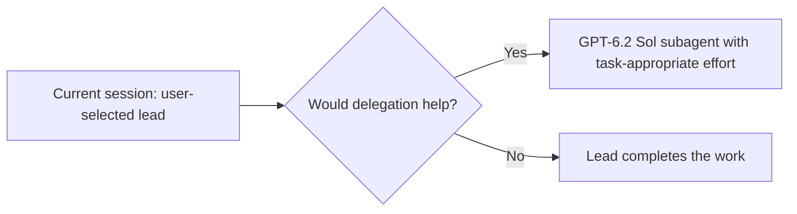

# Adaptive Model Orchestrator

[English](README.md) | [简体中文](README.zh-CN.md)



Adaptive Model Orchestrator is a Codex skill for organizing work across a lead and subagents. The lead keeps the user's selected model and delegates when independently scoped work can improve the result or shorten delivery. Ordinary subagents use GPT-6.2 Sol, with reasoning effort chosen for the task.

For complete projects, long autonomous tasks, and deliveries that should need less supervision, the skill first decides whether delegation is worthwhile. It then assigns work according to readiness, ownership, and expected benefit, and supplies context according to each task. The goal is fewer avoidable handoffs and repeated implementations, shorter delivery cycles, and more reliable results through integrated validation.

Coordination can add upfront analysis, context transfer, and verification costs. Create branches only when the expected benefit outweighs that overhead. More agents do not necessarily use fewer tokens, and a cheaper model does not necessarily consume fewer tokens. Time, cost, and quality improvements are design goals, not measured guarantees; no quantitative comparison is currently published.

## Parallel work and dependencies

- **Keep the lead agent productive**: after delegation, the lead continues independent work with clear ownership. It can wait when no useful, safe work is ready; it does not invent work to stay busy.
- **Dispatch ready tasks together**: independent tasks with a clear expected benefit can start concurrently within the host's available capacity. One level of branches does not mean one subagent, and there is no fixed team size.
- **Use results as dependencies become ready**: check each stable handoff at an appropriate stopping point and unlock its consumers without waiting for unrelated branches. A progress message or intermediate file alone is not a ready dependency.
- **Avoid duplicate work and conflicting edits**: the lead follows the same single-editor boundaries as subagents. Taking over requires the original editor to stop and hand off its work. A broad module name does not make disjoint work conflict.
- **Keep review proportional**: use targeted integration checks as results arrive and validate the final whole. Add an independent reviewer only when its expected value outweighs the handoff and coordination cost.

Complete projects, long autonomous work, and requests for less supervision prompt a collaboration assessment, not automatic delegation. Focused execution gets focused context; decisions about intent, architecture, or the overall result retain original requirements and relevant history. These decisions load with the skill. No additional global `AGENTS.md` rule is needed. Automatic selection still depends on the host, description, and task context; invoke the skill explicitly when you want to ensure it is selected.

## How it routes work

| Task shape | Execution strategy |
|---|---|
| A clear path with no worthwhile independent subtask | Complete it in the current session |
| Multiple tightly coupled steps | Keep one coordinator; delegate only independent research or checks |
| Multiple independently verifiable deliverables | Dispatch ready, non-conflicting tasks concurrently when worthwhile; the lead advances its own work |
| One difficult, indivisible reasoning problem | Assign it to one owner and add independent review when justified |

See [host configuration and reasoning effort](references/runtime.md) for the exact model, the effort table, and when to inherit conversation history. When independent acceptance is needed, the reviewer must not have made the changes they verify. An explicit request to run Deep Project Review follows that skill's own workflow.

## Routing example

User request:

```text
Build and review a full-stack authentication system.
```

Possible orchestration:

1. The lead defines stable interfaces and acceptance criteria.
2. Once those inputs are ready, subagents can implement the frontend and backend concurrently within separate editing boundaries. The lead can prepare integration.
3. If a defect spans both modules, give one owner the relevant evidence and select the effort for the specific difficulty.
4. Check each stable handoff and start the work it unblocks. Validate the integrated system against the original criteria. If an independent reviewer is warranted, give them access to the original requirements and the evidence needed to rerun the key checks.

## Install

Clone the repository into your local Codex skills directory:

```bash
git clone https://github.com/chips-lxm/adaptive-model-orchestrator.git ~/.codex/skills/adaptive-model-orchestrator
```

Start a new Codex conversation after installation. The skill can be selected automatically from its description or invoked explicitly:

```text
Use $adaptive-model-orchestrator to coordinate useful parallel work, wait when dependencies require it, and validate the integrated result.
```

For an existing Git-based installation, preserve any local customizations, then update with:

```bash
git -C ~/.codex/skills/adaptive-model-orchestrator pull --ff-only
```

For a manually copied installation, back up customizations and replace all runtime files and `runtime-manifest.json` together from the same release.

## What is included

```text
adaptive-model-orchestrator/
├── SKILL.md
├── agents/openai.yaml
├── scripts/freeze_run.py
└── references/
    ├── collaboration-and-validation.md
    └── runtime.md
```

- `SKILL.md` contains delegation decisions, constraints, and completion criteria.
- `references/collaboration-and-validation.md` contains handoff fields, state tracking, escalation, and review rules.
- `references/runtime.md` defines the ordinary branch configuration, dispatch options, and evidence for effective settings.
- `agents/openai.yaml` provides Codex-facing display metadata and a default prompt.

## Design principles

- Do not split work merely because it is difficult or has many steps.
- Keep one lead responsible for requirements, dependencies, integration, and acceptance, while also advancing useful independent work.
- Give each file or shared artifact one active editor at a time, including the lead; hand over ownership before taking over edits.
- Validate the integrated result, not just each branch in isolation.
- Report only confirmed model and reasoning settings; mark unavailable fields as unknown instead of treating requested settings as confirmed execution.
- Stop when the acceptance criteria are met.


## Version consistency and validation

For long or multi-agent runs, use `python3 scripts/freeze_run.py --output /absolute/run-evidence/skill-snapshot` outside skill discovery directories. Every child and continuation reads that frozen entrypoint and its relative resources. Verify it with `python3 scripts/freeze_run.py --verify /absolute/run-evidence/skill-snapshot`. The snapshot contains runtime resources, not Git or historical tests. A recorded version number alone does not pin files. Finish active runs or arrange a version boundary before replacing an installation.


Snapshot creation checks the bundled `runtime-manifest.json` and rejects partial installations; distribute it with all runtime resources. After intentional edits, maintainers rebuild it with `python3 -B scripts/freeze_run.py --seal`. Normal runs must not reseal to bypass integrity failures.

See the [change notes](CHANGELOG.md) for release history. Maintainers start with [AGENTS.md](AGENTS.md), [confirmed requirements](REQUIREMENTS.md), and [handoff](HANDOFF.md).

## License

[MIT](LICENSE)
