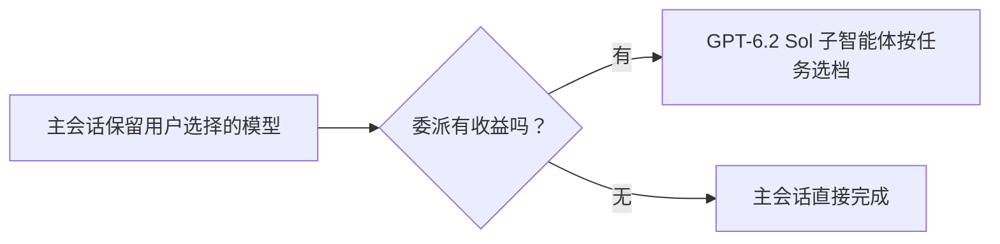

# 自适应多模型编排器

[English](README.md) | [简体中文](README.zh-CN.md)



Adaptive Model Orchestrator 是一个组织主会话和子智能体分工的 Codex Skill。主会话保留用户选择的模型，当任务可独立推进且委派能改善交付质量或时间时才分工。普通子智能体使用 GPT-6.2 Sol，按任务选择推理档位。

面向完整项目、自主长任务和希望减少监督的交付，先判断哪些工作值得分工，再按任务难度、就绪情况、修改边界和背景需求安排主智能体与分支的工作。目标是减少无效往返与重复实现，缩短交付周期，并通过整体验收提高交付可靠性。

协作可能增加前期分析、上下文传递和验证成本。只有预计收益超过这些开销时才创建分支；更多子智能体不等于更省 Token，较便宜的模型也不等于更少用量。时间、费用与质量收益是设计目标，目前没有量化对照数据，不作固定节省或质量保证。

## 并行推进与任务依赖

- **主智能体也承担实际工作**：派发后继续推进修改边界明确的独立工作；没有安全且有收益的工作时允许等待，不为保持忙碌增加无关任务。
- **已就绪任务可以同时派发**：独立、互不冲突且有明确协作收益的任务，可在可用并发额度内同时启动。“一层分支”不等于一个子智能体，也不要求固定团队规模。
- **按依赖接收结果**：在合适的停顿点检查稳定交付，及时启动被它解锁的后续工作，无需等无关分支结束。进度消息或中间文件本身不代表前置产物已就绪。
- **避免重复实现和修改冲突**：主智能体与分支同样遵守单一修改负责人规则，接管前先停止原执行并交接。不能仅因同属一个业务模块，就把修改范围独立的工作串行化。
- **控制检查成本**：结果返回时先做相关集成检查，最终再验收整体；只有独立复核的预期价值超过交接与协调成本时，才另开验收分支。

完整项目、自主长任务和减少监督的请求仍先评估协作收益，不会自动创建分支。局部执行使用必要背景；涉及意图、架构和整体结果的判断保留原始要求与相关历史。这些规则随 skill 按需读取，无需新增全局 `AGENTS.md` 规则。自动匹配仍取决于宿主、技能描述和当前上下文；需要明确使用时，可以直接点名技能。

## 路由规则

| 任务形态 | 执行方式 |
|---|---|
| 路径明确且没有值得独立推进的子任务 | 当前会话直接完成 |
| 多个步骤但依赖紧密 | 由一个负责人统筹，只拆出独立资料或检查任务 |
| 多个可独立交付并验证的部分 | 有收益时同时派发已就绪且互不冲突的任务，主智能体同步推进自己的工作 |
| 困难但不可拆分的核心问题 | 交给一位负责人集中解决，必要时增加独立复核 |

模型参数、档位表和继承规则见 [宿主与推理档位](references/runtime.md)。需要独立验收时，由未参与该项修改的智能体执行。明确要求执行项目深度复审时，按该 Skill 的独立流程处理。

## 完整示例

用户输入：

```text
构建并审查一个全栈身份认证系统。
```

可能的编排结果：

1. 主会话先明确稳定接口和验收标准。
2. 前置输入就绪后，子智能体可并行实现修改边界互不冲突的前端和后端，主会话负责准备集成。
3. 如果出现跨模块缺陷，指定一位负责人，根据实际难点选档，并给到关联证据。
4. 检查稳定的阶段结果，启动前置条件已满足的后续工作。整合系统后对照原始标准验收。需要独立验收时，提供原始要求和复跑关键检查所需的证据。

## 安装

```bash
git clone https://github.com/chips-lxm/adaptive-model-orchestrator.git ~/.codex/skills/adaptive-model-orchestrator
```

安装后开启新的 Codex 对话。Skill 可以根据描述自动匹配，也可以显式调用：

```text
使用 $adaptive-model-orchestrator，协调有实际收益的并行工作，按依赖等待，并完成整体验收。
```

如果原来通过 Git 安装，先保留本地自定义修改，再更新：

```bash
git -C ~/.codex/skills/adaptive-model-orchestrator pull --ff-only
```

如果原来手动复制安装，先备份自定义内容，再从同一发布版本一起同步所有运行文件和 `runtime-manifest.json`。

## 项目结构

```text
adaptive-model-orchestrator/
├── SKILL.md
├── agents/openai.yaml
├── scripts/freeze_run.py
└── references/
    ├── collaboration-and-validation.md
    └── runtime.md
```

- `SKILL.md` 提供委派决策、协作约束和完成标准。
- `references/collaboration-and-validation.md` 记录交接字段、状态管理、升级和验收规则。
- `references/runtime.md` 维护普通分支配置、派发方式和生效证据。
- `agents/openai.yaml` 提供 Codex 界面元数据和默认提示词。

## 设计原则

- 不因为任务困难或步骤多就强行拆分。
- 始终保留一个总负责人维护需求、依赖、集成和验收，同时推进有价值的独立工作。
- 同一文件或共享产物同一时间只有一个修改负责人，主智能体也遵守；接管前先交接修改权。
- 验证集成后的整体结果，而不是只看各分支分别通过。
- 只报告已确认的实际模型和推理强度；环境未提供的信息标为未知，不把请求配置当作实际配置。
- 达到验收标准后停止。


## 运行版本与验证

长任务或多智能体运行时，在不会被自动发现的证据目录使用 `python3 scripts/freeze_run.py --output /绝对路径/本轮证据/skill-snapshot`。所有分支和续答读取快照入口及其相对资源；用 `python3 scripts/freeze_run.py --verify /绝对路径/本轮证据/skill-snapshot` 核对完整性。快照包含运行资源，排除 Git 和历史测试；只记版本号不能固定文件。安装更新应在活动任务结束或安排明确切换点后进行。


快照创建前会核对随包的 `runtime-manifest.json`，拒绝冻结部分更新的安装；该文件必须与运行文件一起同步。维护者在有意修改后用 `python3 -B scripts/freeze_run.py --seal` 重建清单，正常运行不得用它绕过完整性失败。

发布记录见 [更新说明](CHANGELOG.md)。维护入口为 [AGENTS.md](AGENTS.md)、[已确认要求](REQUIREMENTS.md) 和 [交接](HANDOFF.md)。

## 许可证

[MIT](LICENSE)
